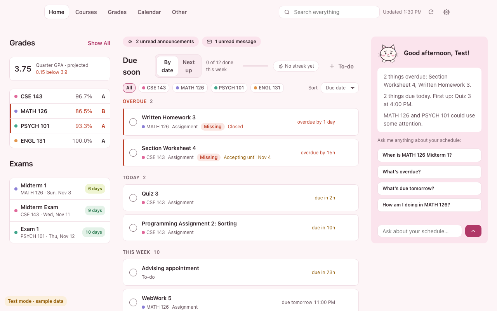
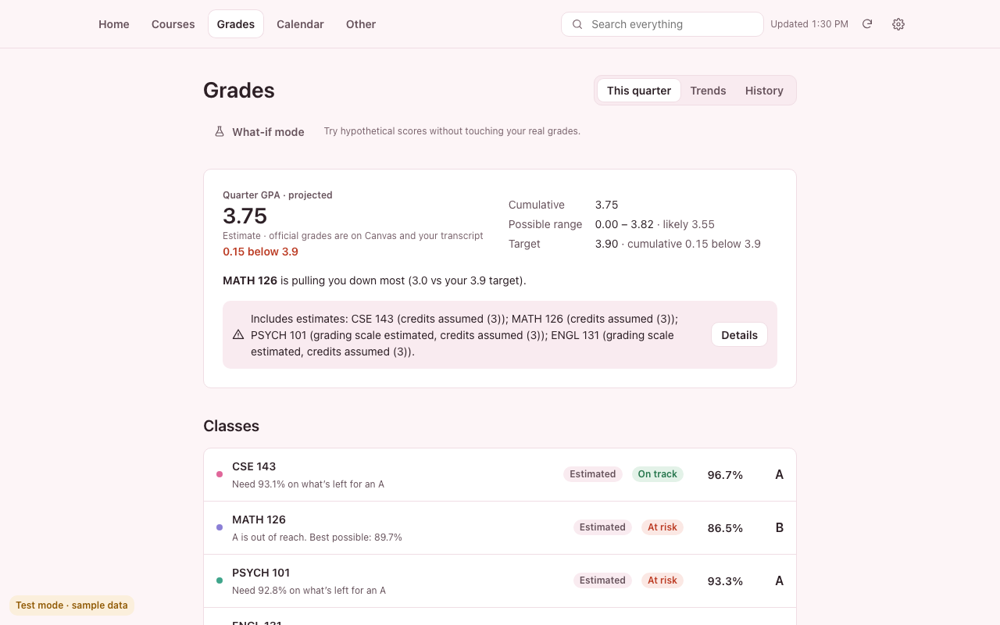
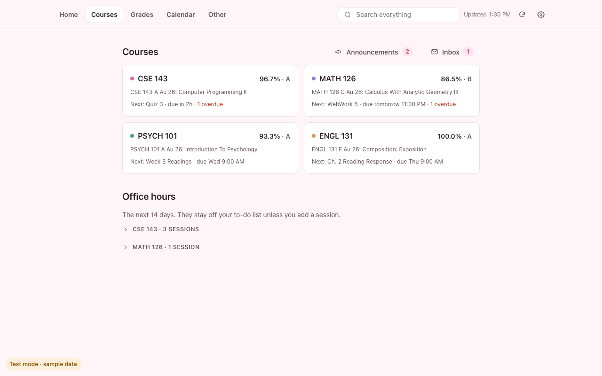

# Neko

A clean, private dashboard that works with Canvas. It's a Chrome extension that replaces the new-tab page with one calm view of everything due, your grades and GPA, a real calendar and your syllabus dates. It reads Canvas with the login you already have and keeps everything on your computer: no account, no server, no analytics.

**Website:** [skim08.github.io/canvas-dashboard](https://skim08.github.io/canvas-dashboard/) · **How it was built with AI:** [BUILDING.md](BUILDING.md)

*Not affiliated with Instructure (the makers of Canvas) or any school.*

| Grades | Courses |
|---|---|
|  |  |

*Screenshots show demo mode: a made-up student, no real data.*

## What it does

- **Due soon:** overdue work, today and the week ahead across every class, with checklists, notes, pins and snooze.
- **Grades and GPA:** the course grade math Canvas uses (weights, dropped scores, extra credit), plus syllabus rules Canvas can't express. Letter or 4.0-decimal grading, what you need on what's left, what-if scores, trends and history.
- **Calendar:** day, week (hour blocks like Apple Calendar), month, term timeline and list views, with class meetings and exams.
- **Syllabus import:** reads PDF and Word syllabi on your computer with no libraries, finds exams, deadlines, class times and days off, and lets you review each one before it's saved.
- **Course content:** announcements, modules, pages, files, discussions and the inbox, without leaving the dashboard.
- **Mochi:** a cat mascot who answers schedule questions from your own data, optionally using Chrome's on-device AI.
- **Works at any school:** you pick your school's Canvas during setup. Quarters or semesters, letter or decimal grades.
- **Demo mode:** try everything with a made-up student, no Canvas account needed.

## How it's built

- **Plain JavaScript modules, no build step and no dependencies.** A tiny DOM helper, whole-app rendering and Chrome Manifest V3.
- **Private by design:**
  - Talks only to the one Canvas site you choose, checked on every request.
  - The public build is read-only and asks Chrome for the minimum permissions.
  - A strict content security policy, and Canvas HTML is sanitized before it's shown.
- **Tested:**
  - 325 browser tests, including hand-calculated grade and GPA math.
  - Build tests that check the published zip.
  - Design checks: design tokens only, and WCAG AA contrast in every theme.
- **Spec-driven:** [`SPEC.md`](SPEC.md) lists every feature with acceptance criteria and status. [`CLAUDE.md`](CLAUDE.md) holds the working rules.
- Built with [Claude Code](https://claude.com/claude-code) as an AI pair programmer, from a written spec with acceptance criteria and automated tests. The process, decisions and lessons are in [BUILDING.md](BUILDING.md).

## Try it

**Load it in Chrome:**

1. Download this repository.
2. Open `chrome://extensions`, turn on **Developer mode** and click **Load unpacked**.
3. Choose this folder.
4. Open a new tab, then pick your school or choose **Try it with sample data**.

**Test mode (no Chrome extension needed):**

1. Run `python3 tools/devserver.py 5319 .`
2. Open `http://localhost:5319/src/newtab.html`.

It uses sample data. Add `?scenario=setup`, `otherschool`, `expired`, `offline` or `empty` to the address to try those cases.

## Checks and builds

| Command | What it does |
|---|---|
| Open `http://localhost:5319/src/tests/index.html` | Runs the browser tests |
| `python3 tools/check_extension.py` | Checks the manifest, that imports resolve, and that no outside hosts are contacted |
| `python3 tools/lint_css.py` | Checks that only design tokens are used |
| `python3 tools/contrast.py` | Checks WCAG AA contrast |
| `python3 tools/test_builds.py` | Checks the owner, public and beta builds |
| `python3 tools/build_zip.py` | Builds the public, read-only Chrome Web Store zip (`--beta` for a beta zip plus install steps) |

## Project layout

| Path | What's there |
|---|---|
| `src/lib/` | Canvas client, sync, grade engine, syllabus import, models (no DOM) |
| `src/ui/` | Screens and components |
| `src/tests/` | Browser tests and sample data |
| `docs/` | Landing site on GitHub Pages, with the privacy policy and terms |
| `store/` | Chrome Web Store listing notes |
| `tools/` | Checks, build and dev server |

## Privacy

Everything stays in Chrome on your computer. The extension never sees your password, has no server and sends nothing to the developer or anyone else. See the [privacy policy](https://skim08.github.io/canvas-dashboard/privacy.html).
